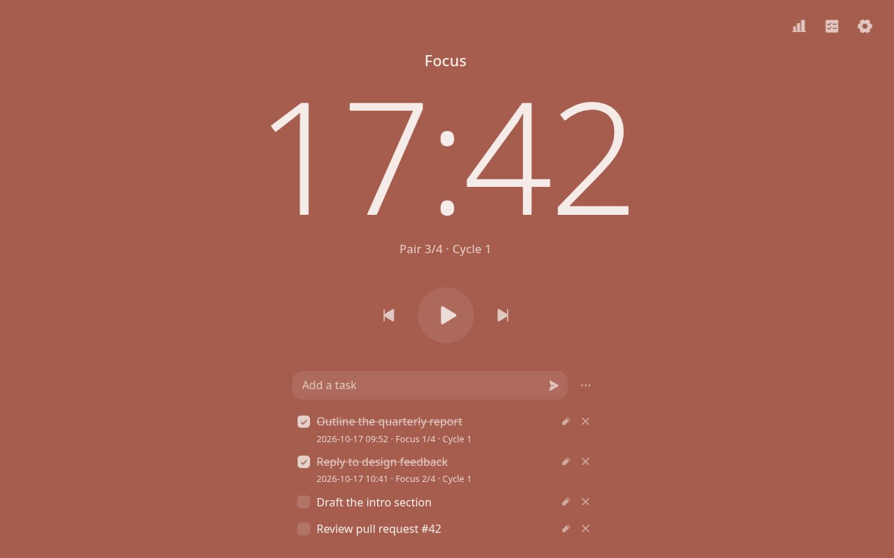
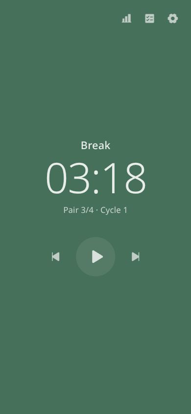
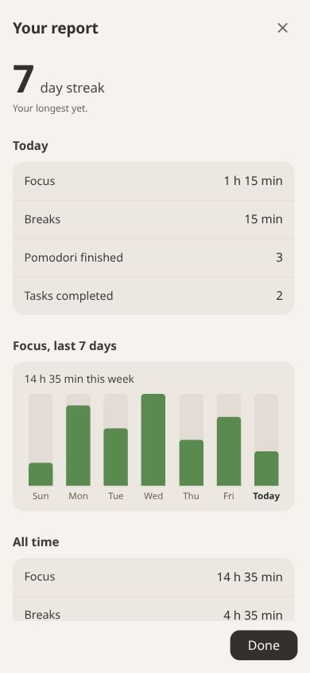
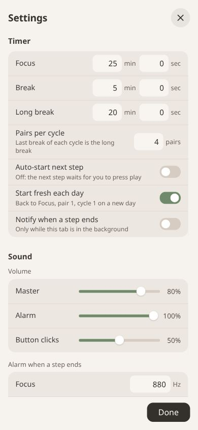

# Pomodoro

A pomodoro timer that runs entirely in your browser. It has no ads and needs no account. Settings, tasks and history are saved in the browser's `localStorage` and never sent anywhere.



<p align="center">
  
  
  
</p>

## Features

### Timer

By default you focus for 25 minutes, then take a 5-minute break. Every 4th break is a 20-minute long break. You can change every length down to the second, and the number of pairs per cycle.

The page and the tab icon take the color of the current step. When a step ends you hear a digital-alarm beep, pitched differently for each step. You can also get a browser notification when the tab is in the background.

The next step waits until you press play, unless you turn on auto-start. Each new day starts again from the first focus step.

### Tasks

You can keep a to-do list under the timer and hide it when you don't need it. Tasks can be edited or deleted one at a time, and the ⋯ menu clears completed, incomplete or all tasks at once. A checked-off task records the time and the step you finished it in, and it stays counted in your report even after you delete it. The list exports and imports as a Markdown checklist.

### Personal report

The report shows your streak, focus and break time, pomodori finished and tasks done for today, the last 7 days and all time. You can export, import or delete it, or turn it off.

### Settings

You can change colors, the font, the timer's weight and style, alarm and click pitches, and separate volumes for the alarm and clicks. Settings export to a JSON file you can load in another browser, and one button puts everything back to the defaults. On a phone, Settings and the report open full screen.

## Keyboard

| Key | Action |
|---|---|
| Space, K or S | Pause / continue |
| ←, J or A | Previous step |
| →, L or D | Next step |
| T | Show or hide tasks |
| I | Settings |
| R | Report |
| ? | List of shortcuts |

## Run it yourself

The app is three static files with no build step. Serve the folder with any web server:

```sh
python -m http.server 8080    # then open http://localhost:8080
```

With nginx or Caddy, point the web root at this folder. Opening `index.html` straight from disk also works, but browsers only allow notifications on `https://` or `localhost`.

## License

MIT, see [LICENSE](LICENSE). You're free to change it, host your own copy or build something else from it. Keep the license notice when you share it. The icons are from [Phosphor](https://phosphoricons.com), also MIT.

The app is provided as is, without warranty. Your data lives only in your browser, so clearing site data deletes it. Export anything you want to keep.
